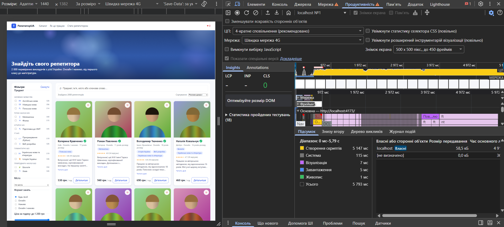

# Звіт про результати аудиту та оптимізації продуктивності

## 1. Умови вимірювання
- **Операційна система:** Windows 11
- **Браузер та версія:** Google Chrome Версія 157.0.8103.51 (64-розрядна)
- **Режим браузера:** Incognito
- **Середовище запуску:** Production-збірка (`npm run build` + `npm run preview`)
- **Версія Node.js:** v24.21.0
- **Версія npm:** 11.19.0
- **CPU Throttling:** 4x slowdown
- **Network Throttling:** Fast 4G
- **Методика:** Кожна метрика розрахована як **медіана з щонайменше 3 окремих запусків**.

*Примітка:* Усі порівнювані вимірювання виконувалися за однакових умов. React Profiler використовувався окремо в dev-режимі для діагностики компонентів.

**Перевірка початкового проєкту:**
* Залежності успішно встановлено (`npm install`). Надійшло повідомлення про 3 вразливості (1 помірна, 2 критичні), які на цьому етапі не оновлювалися.
* Застосунок успішно запущено (`npm run dev` / `npm run preview`).
* Початкове тестування пройдено успішно (1 тестовий файл, 1 тест успішно). Помилок на початку роботи не виявлено.

---

## 2. Базова лінія (Baseline) та результати

### 2.1. Сценарій 1 — Завантаження сторінки
*Послідовність дій:* відкриття каталогу, очікування завершення завантаження, запис Performance Trace та аудит Lighthouse у режимі Navigation, Desktop.

| Метрика | Запуск 1 | Запуск 2 | Запуск 3 | Медіана |
| :--- | :---: | :---: | :---: | :---: |
| Lighthouse Performance Score | 40 | 39 | 22 | **39** |
| Largest Contentful Paint (LCP), с | 3,7 | 4 | 3,7 | **3,7** |
| First Contentful Paint (FCP), с | 0,7 | 0,8 | 0,7 | **0,7** |
| Cumulative Layout Shift (CLS) | 0 | 0 | 0,36 | **0** |
| Total Blocking Time (TBT), мс | 6400 | 6940 | 7270 | **6940** |
| Long Tasks, шт. | 2 | 2 | 2 | **2** |

* **Докази:** 
- Скріншоти:
`report/baseline/load/`,
`report/baseline/load/lighthouse/`
- Логи: `report/baseline/load/run-1.json`, `run-2.json`, `run-3.json`, `lighthouse/`

---

### 2.2. Сценарій 2 — Введення тексту в пошук
*Пошуковий запит:* математика.  
*Послідовність дій:* введення однакового тексту в поле пошуку, очікування оновлення результатів та запис Performance Trace.

| Метрика | Запуск 1 | Запуск 2 | Запуск 3 | Медіана |
| :--- | :---: | :---: | :---: | :---: |
| INP (Interaction to Next Paint), мс | 9977 | 12 296 | 9447 | **9977** |
| Longest JS task (Найдовша JS-задача), мс | 7221 | 9600 | 7061 | **7221** |
| Сума блокування Long Tasks, мс | 10 466 | 12 519 | 9 693 | **10 466** |
| Кількість Long Tasks | 5 | 5 | 4 | **5** |

* **Докази:** 
- Скріншот: `report/baseline/search/`
- Логи: `report/baseline/search/run-1.json`, `run-2.json`, `run-3.json`

---

### 2.3. Сценарій 3 — Дії зі списком (кліки та скрол)
*Послідовність дій:* натискання кнопки додавання репетитора в обране, прокручування списку приблизно на три висоти екрана, відкриття та закриття картки репетитора, повернення до початку списку.

| Метрика | Запуск 1 | Запуск 2 | Запуск 3 | Медіана |
| :--- | :---: | :---: | :---: | :---: |
| INP (Interaction to Next Paint), мс | 4179 | 6534 | 3610 | **4179** |
| Longest JS task (Найдовша JS-задача), мс | 4048 | 6386 | 3514 | **4048** |
| Час обробника скролу вниз, мс | 5018 | 4238 | 4202 | **4238** |
| Час обробника скролу вгору, мс | 2082 | 3023 | 3025 | **3023** |
| Час обробника кліку на favourite, мс | 2976 | 4509 | 2611 | **2976** |
| Час обробника кліку на картку викладача, мс | 3790 | 5927 | 3319 | **3790** |
| Час обробника кліку на закриття картки, мс | 3883 | 6077 | 3295 | **3883** |
| Частково відображені фрейми | 8 | 16 | 13 | **13** |
| Пропущені фрейми | — | 2 | 2 | **2** |

* **Докази:** 
- Скріншот: `report/baseline/list/`
- Логи: `report/baseline/list/run-1.json`, `run-2.json`, `run-3.json`

.png)

---

## 3. Припущення та гіпотези (на основі DevTools до аналізу коду)

На основі отриманих трейсів, графіків та звітів DevTools сформульовано наступні гіпотези щодо причин повільної роботи:

1. **Гіпотеза 1. Блокування головного потоку під час початкового завантаження сторінки**
   - *Спостереження:* На записі Performance (`baseline-load-1.jpg`) у доріжці Main (CrRendererMain) спостерігається велика кількість тривалих завдань, які займають значну частину часу початкового завантаження. Результати Lighthouse (`lighthouse-run-2.jpg`) також підтверджують проблему: Performance Score становить 39 балів, Total Blocking Time — 6940 мс, а Largest Contentful Paint — 4,0 с.
   - *Припущення:* Початкове завантаження каталогу супроводжується значним обсягом обчислень та операцій відображення контенту. Імовірно, браузер витрачає багато часу на виконання JavaScript, обробку даних і побудову великого DOM-дерева. Через зайнятість головного потоку затримується відображення основного контенту та погіршується швидкість реагування сторінки.

2. **Гіпотеза 2. Надмірна кількість мережевих запитів і завантаження зображень**
   - *Спостереження:* У вкладці Network (`baseline-load-Network.jpg`) зафіксовано 113 запитів із загальним обсягом переданих даних 66,3 МБ. Значну частину запитів становлять зображення репетиторів, розмір окремих файлів яких сягає приблизно 600 КБ. Події DOMContentLoaded та Load відбуваються приблизно через 10,19–10,20 с.
   - *Припущення:* Значний обсяг мережевого трафіку може бути пов'язаний із завантаженням великої кількості зображень каталогу, зокрема тих, які не потрапляють у початкову видиму область сторінки. Відсутність відкладеного завантаження та достатнього стиснення зображень може збільшувати кількість одночасних мережевих запитів і час отримання ресурсів.

3. **Гіпотеза 3. Тривале виконання операцій під час пошуку**
   - *Спостереження:* Під час введення запиту «математика» (`baseline-search-1.jpg`) у Performance зафіксовано тривалі події введення тексту та виконання JavaScript. Медіанне значення INP становить 9977 мс, а найдовша JavaScript-задача — 7221 мс. Після застосування фільтра кількість знайдених репетиторів зменшується до 340, проте оновлення результатів супроводжується значною затримкою.
   - *Припущення:* Обробка пошукового запиту може вимагати надмірної кількості обчислень над великим набором даних. Імовірно, фільтрація, перевірка текстових збігів, сортування та оновлення списку виконуються синхронно в головному потоці. Повторне виконання цих операцій під час введення кожного символу може спричиняти накопичення довгих JavaScript-задач і затримувати відображення результатів.

4. **Гіпотеза 4. Надмірні витрати часу на обробку DOM та перерахунок макета під час взаємодії (Layout)**
   - *Спостереження:* У записі Performance (`baseline-list-2(2).jpg`) у Call Tree зафіксовано значні витрати часу на виконання JavaScript та операції отримання геометричних характеристик DOM-елементів, зокрема getClientRect. Для одного з вузлів зафіксовано сумарний час 23 816 мс, що становить понад 61% відображеного активного часу. В іншому записі (`baseline-list-2_2.jpg`) значення INP сягає 6534 мс, а взаємодії супроводжуються тривалими завданнями на головному потоці.
   - *Припущення:* Під час взаємодії з картками та прокручування сторінки браузер може витрачати значний час на отримання розмірів і розташування елементів, перерахунок стилів та компонування сторінки. Часте поєднання читання геометричних властивостей DOM зі змінами його структури або стилів може спричиняти примусові перерахунки макета (forced reflow) і погіршувати плавність роботи інтерфейсу.

5. **Гіпотеза 5. Затримки відображення інтерфейсу після дій користувача**
   - *Спостереження:* У сценарії взаємодії зі списком медіанне значення INP становить 4179 мс, а в окремому записі Performance зафіксовано значення 6534 мс. На таймлайні видно, що після подій натискання миші виконуються тривалі завдання, протягом яких браузер не може своєчасно завершити оновлення та відображення інтерфейсу.
   - *Припущення:* Затримки після натискання кнопок обраного, відкриття або закриття карток можуть бути пов'язані з надмірним обсягом роботи, що виконується у відповідь на зміну стану застосунку. Зокрема, можливими причинами є повторне рендерення великої кількості компонентів, виконання додаткових обчислень та операції оновлення DOM. Це може призводити до того, що користувач бачить результат своєї дії із суттєвим запізненням.

---

## 4. Виправлення та повторні вимірювання (заповнюється по мірі роботи)
*(В процесі виконання)*