# Звіт про результати аудиту та оптимізації продуктивності

## 1. Умови вимірювання
- **Операційна система:** Windows 11
- **Браузер та версія:** Google Chrome Версія 157.0.8103.51 (64-розрядна)
- **Режим браузера:** Incognito
- **Середовище запуску:** Production-збірка (`npm run build` + `npm run preview`)
- **Версія Node.js:** v24.21.0
- **Версія npm:** 11.19.0
- **CPU Throttling:** 4x slowdown
- **Network Throttling:** Fast 4G
- **Методика:** Кожна метрика розрахована як **медіана з щонайменше 3 окремих запусків**.

*Примітка:* Усі порівнювані вимірювання виконувалися за однакових умов. React Profiler використовувався окремо в dev-режимі для діагностики компонентів.

**Перевірка початкового проєкту:**
* Залежності успішно встановлено (`npm install`). Надійшло повідомлення про 3 вразливості (1 помірна, 2 критичні), які на цьому етапі не оновлювалися.
* Застосунок успішно запущено (`npm run dev` / `npm run preview`).
* Початкове тестування пройдено успішно (1 тестовий файл, 1 тест успішно). Помилок на початку роботи не виявлено.

---

## 2. Базова лінія (Baseline) та результати

### 2.1. Сценарій 1 — Завантаження сторінки
*Послідовність дій:* відкриття каталогу, очікування завершення завантаження, запис Performance Trace та аудит Lighthouse у режимі Navigation, Desktop.

| Метрика | Запуск 1 | Запуск 2 | Запуск 3 | Медіана |
| :--- | :---: | :---: | :---: | :---: |
| Lighthouse Performance Score | 40 | 39 | 22 | **39** |
| Largest Contentful Paint (LCP), с | 3,7 | 4 | 3,7 | **3,7** |
| First Contentful Paint (FCP), с | 0,7 | 0,8 | 0,7 | **0,7** |
| Cumulative Layout Shift (CLS) | 0 | 0 | 0,36 | **0** |
| Total Blocking Time (TBT), мс | 6400 | 6940 | 7270 | **6940** |
| Long Tasks, шт. | 2 | 2 | 2 | **2** |

* **Докази:** 
- Скріншоти:
`report/baseline/load/`,
`report/baseline/load/lighthouse/`
- Логи: `report/baseline/load/run-1.json`, `run-2.json`, `run-3.json`, `lighthouse/`
   
   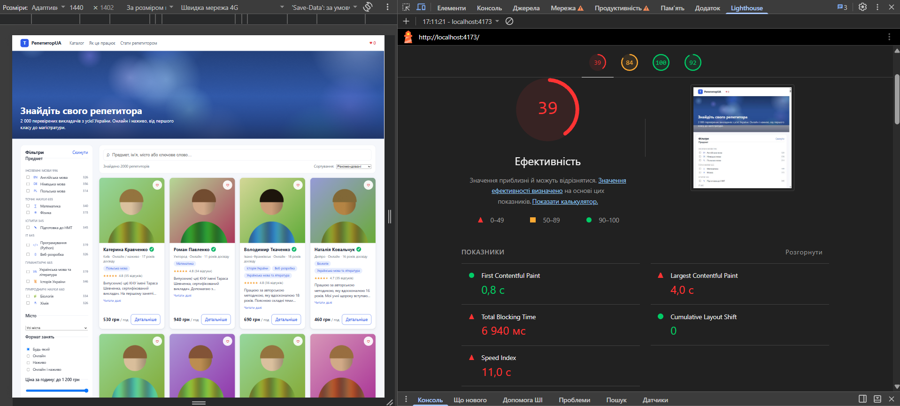
   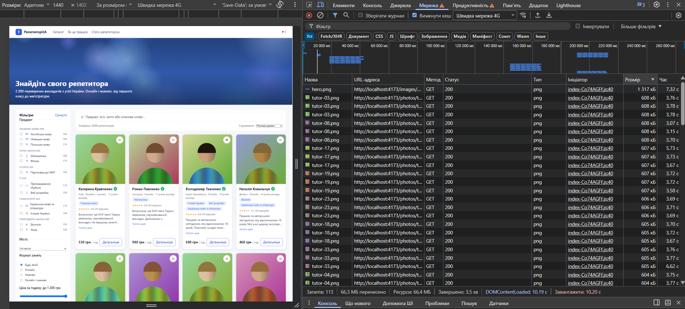

---

### 2.2. Сценарій 2 — Введення тексту в пошук
*Пошуковий запит:* математика.  
*Послідовність дій:* введення однакового тексту в поле пошуку, очікування оновлення результатів та запис Performance Trace.

| Метрика | Запуск 1 | Запуск 2 | Запуск 3 | Медіана |
| :--- | :---: | :---: | :---: | :---: |
| INP (Interaction to Next Paint), мс | 9977 | 12 296 | 9447 | **9977** |
| Longest JS task (Найдовша JS-задача), мс | 7221 | 9600 | 7061 | **7221** |
| Сума блокування Long Tasks, мс | 10 466 | 12 519 | 9 693 | **10 466** |
| Кількість Long Tasks | 5 | 5 | 4 | **5** |

* **Докази:** 
- Скріншот: `report/baseline/search/`
- Логи: `report/baseline/search/run-1.json`, `run-2.json`, `run-3.json`
   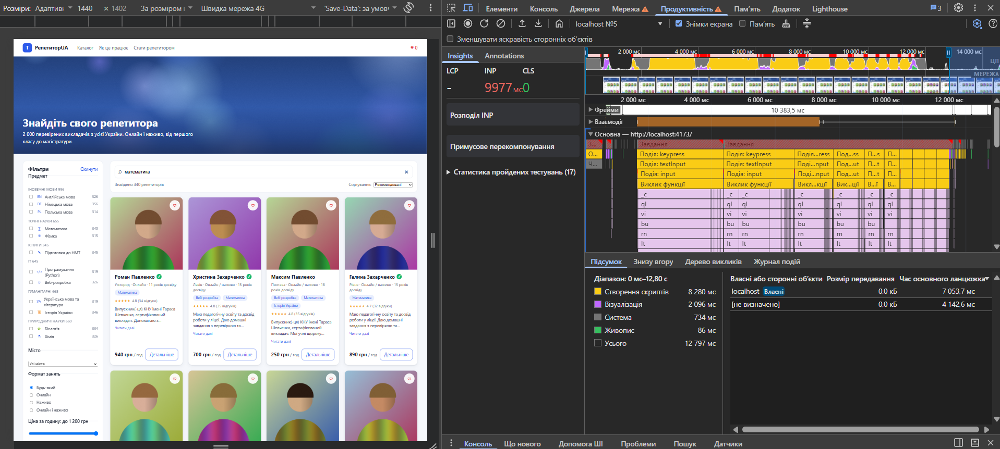

---

### 2.3. Сценарій 3 — Дії зі списком (кліки та скрол)
*Послідовність дій:* натискання кнопки додавання репетитора в обране, прокручування списку приблизно на три висоти екрана, відкриття та закриття картки репетитора, повернення до початку списку.

| Метрика | Запуск 1 | Запуск 2 | Запуск 3 | Медіана |
| :--- | :---: | :---: | :---: | :---: |
| INP (Interaction to Next Paint), мс | 4179 | 6534 | 3610 | **4179** |
| Longest JS task (Найдовша JS-задача), мс | 4048 | 6386 | 3514 | **4048** |
| Час обробника скролу вниз, мс | 5018 | 4238 | 4202 | **4238** |
| Час обробника скролу вгору, мс | 2082 | 3023 | 3025 | **3023** |
| Час обробника кліку на favourite, мс | 2976 | 4509 | 2611 | **2976** |
| Час обробника кліку на картку викладача, мс | 3790 | 5927 | 3319 | **3790** |
| Час обробника кліку на закриття картки, мс | 3883 | 6077 | 3295 | **3883** |
| Частково відображені фрейми | 8 | 16 | 13 | **13** |
| Пропущені фрейми | — | 2 | 2 | **2** |

* **Докази:** 
- Скріншот: `report/baseline/list/`
- Логи: `report/baseline/list/run-1.json`, `run-2.json`, `run-3.json`
   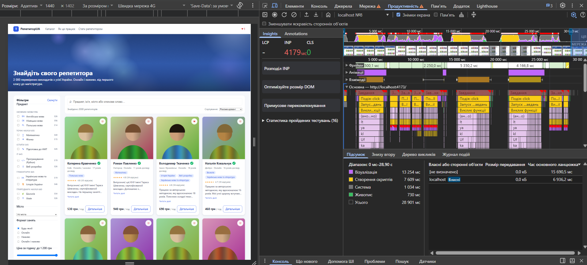
   .png)

---

## 3. Припущення та гіпотези (на основі DevTools до аналізу коду)

На основі отриманих трейсів, графіків та звітів DevTools сформульовано наступні гіпотези щодо причин повільної роботи:

1. **Гіпотеза 1. Блокування головного потоку під час початкового завантаження сторінки**
   - *Спостереження:* На записі Performance (`baseline-load-1.jpg`) у доріжці Main (CrRendererMain) спостерігається велика кількість тривалих завдань, які займають значну частину часу початкового завантаження. Результати Lighthouse (`lighthouse-run-2.jpg`) також підтверджують проблему: Performance Score становить 39 балів, Total Blocking Time — 6940 мс, а Largest Contentful Paint — 4,0 с.
   - *Припущення:* Початкове завантаження каталогу супроводжується значним обсягом обчислень та операцій відображення контенту. Імовірно, браузер витрачає багато часу на виконання JavaScript, обробку даних і побудову великого DOM-дерева. Через зайнятість головного потоку затримується відображення основного контенту та погіршується швидкість реагування сторінки.

2. **Гіпотеза 2. Надмірна кількість мережевих запитів і завантаження зображень**
   - *Спостереження:* У вкладці Network (`baseline-load-Network.jpg`) зафіксовано 113 запитів із загальним обсягом переданих даних 66,3 МБ. Значну частину запитів становлять зображення репетиторів, розмір окремих файлів яких сягає приблизно 600 КБ. Події DOMContentLoaded та Load відбуваються приблизно через 10,19–10,20 с.
   - *Припущення:* Значний обсяг мережевого трафіку може бути пов'язаний із завантаженням великої кількості зображень каталогу, зокрема тих, які не потрапляють у початкову видиму область сторінки. Відсутність відкладеного завантаження та достатнього стиснення зображень може збільшувати кількість одночасних мережевих запитів і час отримання ресурсів.

3. **Гіпотеза 3. Тривале виконання операцій під час пошуку**
   - *Спостереження:* Під час введення запиту «математика» (`baseline-search-1.jpg`) у Performance зафіксовано тривалі події введення тексту та виконання JavaScript. Медіанне значення INP становить 9977 мс, а найдовша JavaScript-задача — 7221 мс. Після застосування фільтра кількість знайдених репетиторів зменшується до 340, проте оновлення результатів супроводжується значною затримкою.
   - *Припущення:* Обробка пошукового запиту може вимагати надмірної кількості обчислень над великим набором даних. Імовірно, фільтрація, перевірка текстових збігів, сортування та оновлення списку виконуються синхронно в головному потоці. Повторне виконання цих операцій під час введення кожного символу може спричиняти накопичення довгих JavaScript-задач і затримувати відображення результатів.

4. **Гіпотеза 4. Надмірні витрати часу на обробку DOM та перерахунок макета під час взаємодії (Layout)**
   - *Спостереження:* У записі Performance (`baseline-list-2(2).jpg`) у Call Tree зафіксовано значні витрати часу на виконання JavaScript та операції отримання геометричних характеристик DOM-елементів, зокрема getClientRect. Для одного з вузлів зафіксовано сумарний час 23 816 мс, що становить понад 61% відображеного активного часу. В іншому записі (`baseline-list-2_2.jpg`) значення INP сягає 6534 мс, а взаємодії супроводжуються тривалими завданнями на головному потоці.
   - *Припущення:* Під час взаємодії з картками та прокручування сторінки браузер може витрачати значний час на отримання розмірів і розташування елементів, перерахунок стилів та компонування сторінки. Часте поєднання читання геометричних властивостей DOM зі змінами його структури або стилів може спричиняти примусові перерахунки макета (forced reflow) і погіршувати плавність роботи інтерфейсу.

5. **Гіпотеза 5. Затримки відображення інтерфейсу після дій користувача**
   - *Спостереження:* Lighthouse виявив, що головне зображення hero.png має розмір приблизно 1286 КіБ, хоча відображається у розмірі близько 1130 × 424 px. У звіті також зазначено потенційну економію понад 1200 КіБ для цього зображення.
   - *Припущення:* Використання сучасного формату WebP та оптимізація розмірів зображення дозволять зменшити обсяг завантажуваних даних, скоротити час завантаження LCP-елемента та покращити показник Lighthouse Performance.

---

## 4. Виправлення та повторні вимірювання (заповнюється по мірі роботи)

### Виправлення 1: Порційне відображення карток репетиторів

- **Коміт:** commit 57c57c ("perf: implement pagination/load-more for tutor cards to optimize initial DOM load")
- **Сценарій:** Початкове завантаження сторінки.
- **Підтверджена причина:** До оптимізації застосунок відображав усі 2000 карток репетиторів одночасно, що збільшувало початковий обсяг DOM та навантаження на головний потік.
- **Що змінено у коді:**
  1. У `TutorList.jsx` реалізовано порційне відображення карток по 20 елементів.
  2. Додано кнопку «Показати ще» для поступового завантаження наступних карток.
  3. У `App.jsx` передано ключ критеріїв каталогу для коректного скидання кількості карток після зміни пошуку, фільтрів або сортування.
  4. Оновлено залежності `useBioClamp` для перевірки після зміни відображуваної порції.

- **Результати вимірювань:**

| Метрика | До (медіана) | Після, запуск 1 | Після, запуск 2 | Після, запуск 3 | **Після (медіана)** | Зміна |
| :--- | :---: | :---: | :---: | :---: | :---: | :---: |
| **Lighthouse Performance Score** | 39 | 35 | 38 | 36 | **36** | -3 бали |
| **LCP** (Largest Contentful Paint), с | 3,7 | 1,7 | 1,5 | 1,6 | **1,6** | **-56,8%** (покращення) |
| **FCP** (First Contentful Paint), с | 0,7 | 0,8 | 0,7 | 0,7 | **0,7** | без змін |
| **TBT** (Total Blocking Time), мс | 6940 | 3290 | 2910 | 3880 | **3290** | **-52,6%** (покращення) |
| **CLS** (Cumulative Layout Shift) | 0 | 0,356 | 0,356 | 0,356 | **0,356** | +0,356 (регресія) |
| **Long Tasks**, шт. | 2 | 6 | 4 | 5 | **5** | +3 задачі |
| **Кількість початкових карток DOM** | 2000 | 20 | 20 | 20 | **20** | **-99%** (покращення) |

- **Скріншоти після оптимізації:**
  
  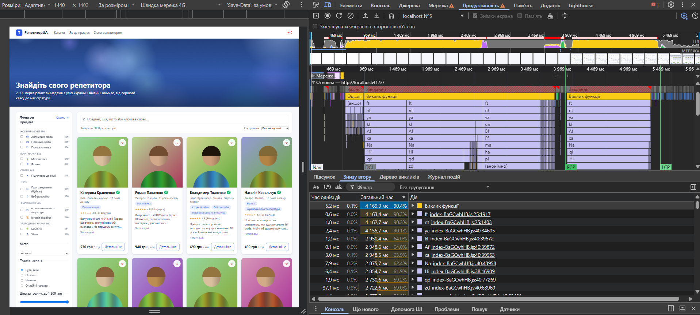

### Виправлення 2: Оптимізація завантаження зображень

- **Коміт:** 02de3e (perf: optimize image loading + reorganize change01 directory)
- **Гіпотеза:** Надмірна кількість мережевих запитів і завантаження зображень.
- **Сценарій:** Початкове завантаження сторінки та подальше прокручування каталогу.

**Підтверджена причина:**

До оптимізації зображення карток репетиторів завантажувалися без механізму відкладеного завантаження. Це могло спричиняти отримання зображень, які ще не були потрібні користувачу, та збільшувати початковий обсяг мережевого трафіку.

**Що змінено у коді:**

1. У `TutorCard.jsx` додано `loading="lazy"` для відкладеного завантаження фотографій репетиторів.
2. Додано `decoding="async"` для асинхронного декодування зображень.
3. Додано атрибути `width` та `height` для резервування місця під фотографії.
4. У `Header.jsx` для головного зображення Hero встановлено `fetchPriority="high"`, оскільки воно розташоване у початковій видимій області сторінки.
5. Для Hero вказано фактичні розміри зображення — 2400 × 900 px.

**Результати Network:**

| Метрика | Запуск 1 | Запуск 2 | Запуск 3 | Медіана |
| :--- | :---: | :---: | :---: | :---: |
| Requests, шт. | 19 | 19 | 19 | **19** |
| Transferred, МБ | 9,8 | 9,8 | 9,8 | **9,8** |
| Resources, МБ | 9,9 | 9,9 | 9,9 | **9,9** |
| Запити до зображень, шт. | 15 | 15 | 15 | **15** |
| Обсяг зображень, МБ | 9,75 | 9,75 | 9,75 | **9,75** |
| DOMContentLoaded, с | 1,03 | 1,16 | 0,925 | **1,03** |
| Load, с | 1,03 | 1,16 | 0,926 | **1,03** |

**Результати Lighthouse:**

| Метрика | До (медіана) | Після, запуск 1 | Після, запуск 2 | Після, запуск 3 | **Після (медіана)** | Зміна |
| :--- | :---: | :---: | :---: | :---: | :---: | :---: |
| **Performance Score** | 36 | 51 | 53 | 52 | **52** | +16 балів (покращення) |
| **LCP** (Largest Contentful Paint), с | 1,6 | 3,3 | 3,3 | 3,3 | **3,3** | +1,7 с (регресія) |
| **FCP** (First Contentful Paint), с | 0,7 | 0,7 | 0,7 | 0,7 | **0,7** | без змін |
| **TBT** (Total Blocking Time), мс | 3290 | 610 | 510 | 550 | **550** | **-83,3%** (покращення) |
| **CLS** (Cumulative Layout Shift) | 0,356 | 0 | 0 | 0 | **0** | **100%** (виправлено до 0) |

**Перевірка lazy loading:**

Після початкового завантаження сторінки перевірено, що фотографії карток, розташованих поза видимою областю, не завантажуються завчасно. Під час прокручування каталогу та натискання кнопки «Показати ще» браузер надсилає запити на отримання наступних зображень.

**Докази:**
- **Скріншоти після оптимізації:**

   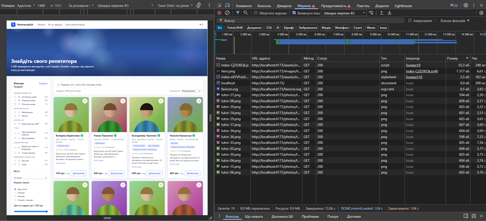
   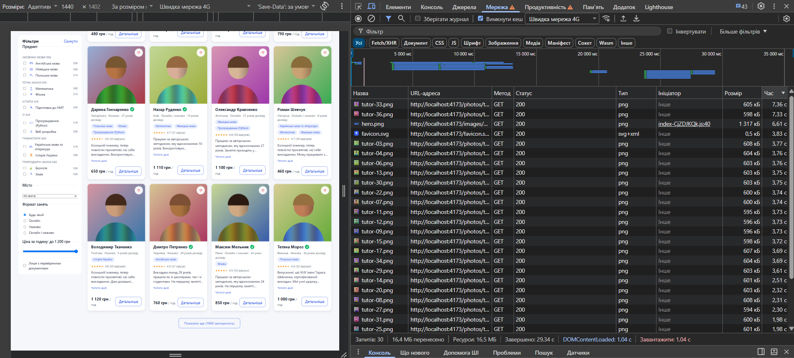
   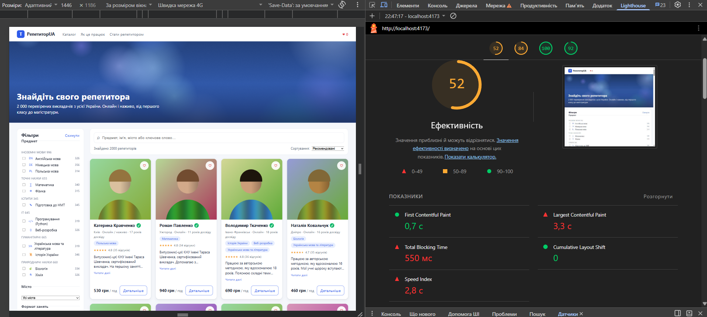
   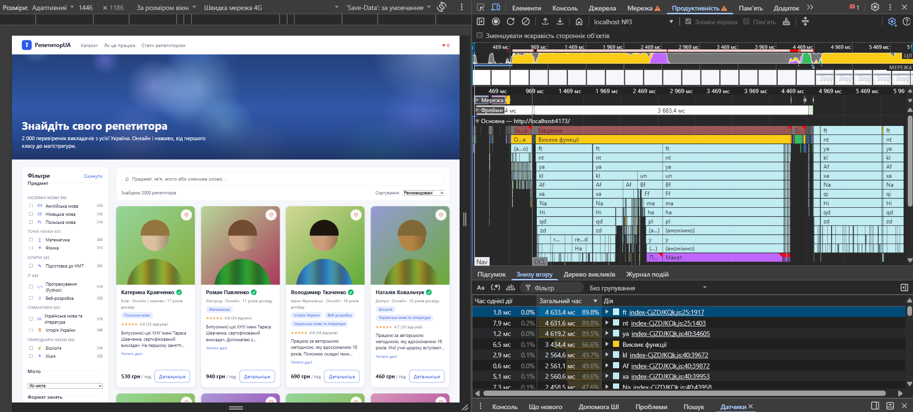

### Виправлення 3: Оптимізація пошуку та повторних обчислень

- **Коміт:** 11bf18 (perf: optimize tutor search and catalog calculations)
- **Гіпотеза:** Тривале виконання операцій під час пошуку.
- **Сценарій:** Введення пошукового запиту «математика» та очікування оновлення результатів.

**Підтверджена причина:**

До оптимізації під час введення пошукового запиту виконувалася значна кількість синхронних обчислень над каталогом із 2000 репетиторів. Зокрема, повторно оброблялися текстові дані кожного репетитора, виконувалася фільтрація та сортування результатів. Також під час сортування могли повторно обчислюватися рейтингові показники.

Ці операції створювали значне навантаження на головний потік браузера, що призводило до тривалих JavaScript-задач і затримок оновлення інтерфейсу після введення тексту.

**Що змінено у коді:**

1. У `App.jsx` використано `useDeferredValue` для відкладеного оновлення пошукового запиту. Це дозволяє не блокувати введення тексту користувачем через негайне виконання важких обчислень.
2. У `App.jsx` використано `useMemo` для мемоізації результатів фільтрації, пошуку та сортування. Обчислення повторюються лише тоді, коли змінюються залежності: пошуковий запит, фільтри або спосіб сортування.
3. У `text.js` додано кешування нормалізованого тексту репетиторів за допомогою `WeakMap`. Це дозволяє не виконувати повторну нормалізацію і формування текстового рядка під час кожного пошукового запиту.
4. У `text.js` додано збереження останнього нормалізованого пошукового запиту та його окремих слів, щоб не повторювати ці операції для кожного репетитора.
5. У `rating.js` додано кешування розрахованих рейтингових оцінок за допомогою `WeakMap`, щоб уникнути повторного виконання однакових обчислень під час сортування.
6. У `Filters.jsx` використано `useMemo` для формування кількості репетиторів за предметами та побудови списку доступних предметів. Це запобігає повторному проходженню всього каталогу під час кожного рендерення компонента.

**Результати вимірювань до оптимізації (після гіпотез 1 і 2):**

| Метрика | Запуск 1 | Запуск 2 | Запуск 3 | Медіана |
| :--- | :---: | :---: | :---: | :---: |
| INP (Interaction to Next Paint), мс | 5148 | 4140 | 4961 | **4961** |
| Найдовша JS-задача під час пошуку, мс | 3593 | 2771 | 3654 | **3593** |
| Сумарний Blocking Time Long Tasks, мс | 6640 | 5505 | 5532 | **5532** |
| Кількість Long Tasks | 4 | 4 | 4 | **4** |

**Результати вимірювань після оптимізації:**

| Метрика | Запуск 1 | Запуск 2 | Запуск 3 | Медіана |
| :--- | :---: | :---: | :---: | :---: |
| INP (Interaction to Next Paint), мс | 147 | 132 | 121 | **132** |
| Найдовша JS-задача під час пошуку, мс | 95 | 67 | 101 | **95** |
| Сумарний Blocking Time Long Tasks, мс | 193 | 175 | 222 | **193** |
| Кількість Long Tasks | 11 | 7 | 7 | **7** |

**Порівняння результатів до та після оптимізації:**

| Метрика | До (медіана) | Після (медіана) | Зміна |
| :--- | :---: | :---: | :---: |
| **INP**, мс | 4961 | 132 | **−97,3%** (покращення) |
| **Найдовша JS-задача**, мс | 3593 | 95 | **−97,4%** (покращення) |
| **Сумарний Blocking Time**, мс | 5532 | 193 | **−96,5%** (покращення) |
| **Кількість Long Tasks** | 4 | 7 | +3 задачі (регресія) |

**Докази:**
- **Скріншоти до та після оптимізації:**
   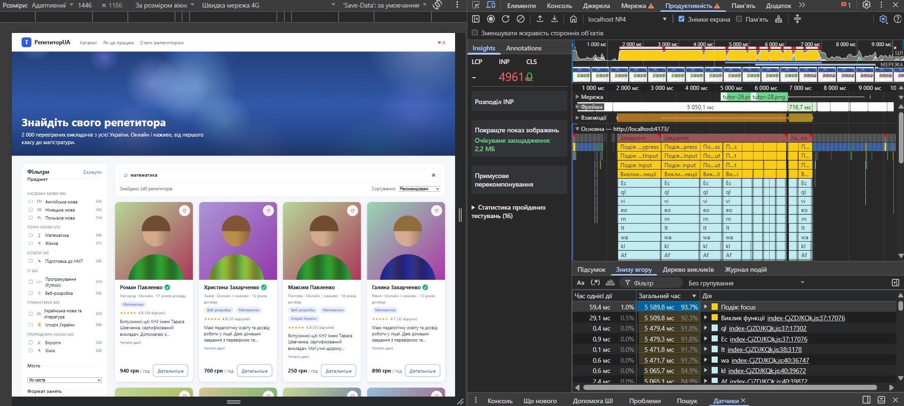
   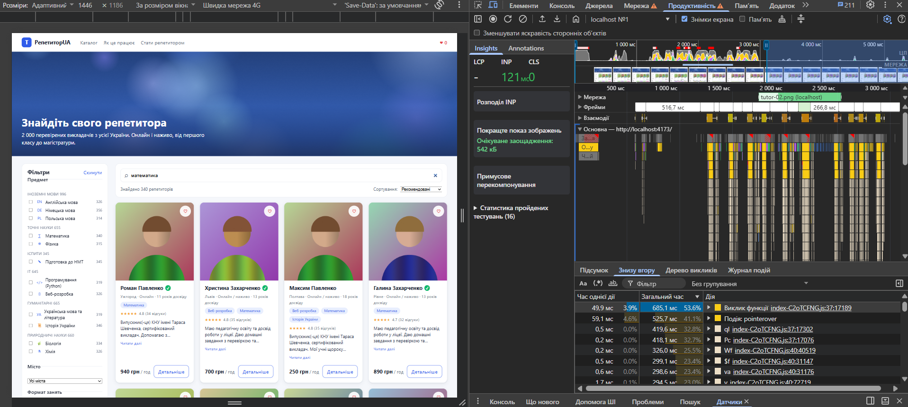

### Виправлення 4: Усунення зайвих перерахунків макета під час прокручування

- **Коміт:** 4726fa (perf: reduce layout recalculations in tutor bio clamp)
- **Гіпотеза:** Надмірні витрати часу на обробку DOM та перерахунок макета під час взаємодії (Layout).
- **Сценарій:** Прокручування каталогу репетиторів униз і вгору приблизно на три висоти екрана.

**Підтверджена причина:**

Під час аналізу коду `src/hooks/useBioClamp.js` виявлено, що перевірка висоти біографій репетиторів виконувалася під час кожної події `scroll`. Для визначення наявності прихованого тексту хук знімав CSS-клас `.is-clamped`, зчитував `offsetHeight`, після чого повертав клас і повторно зчитував геометрію елемента.

Таке чергування змін DOM та читання геометричних властивостей могло спричиняти примусовий синхронний перерахунок макета (forced reflow). Повторне виконання цих операцій під час прокручування створювало додаткове навантаження на головний потік браузера.

**Що змінено у коді (`src/hooks/useBioClamp.js`):**

1. Замінено `useLayoutEffect` на `useEffect`, оскільки перевірка переповнення біографій не потребує синхронного виконання до відображення кадру.
2. Видалено обробник події `scroll`. Перевірка тепер виконується після монтування компонента, зміни залежностей ефекту та зміни розміру вікна (`resize`).
3. Видалено використання `getBoundingClientRect()` та `offsetHeight` для вимірювання біографій.
4. Для визначення наявності прихованого тексту використано `bio.scrollHeight > bio.clientHeight + 1`.
5. Розділено роботу з DOM на два етапи: спочатку збираються результати вимірювання всіх біографій, потім оновлюються CSS-класи карток (`has-more`).

**Результати вимірювань до оптимізації:**

| Метрика | Запуск 1 | Запуск 2 | Запуск 3 | Медіана |
| :--- | :---: | :---: | :---: | :---: |
| Layout, мс | 2910 | 2607 | 2358 | 2607 |
| Recalculate Style, мс | 559 | 462 | 474 | 474 |
| Scripting, мс | 804 | 632 | 596 | 632 |
| Найдовша задача Main Thread, мс | 374 (scroll вгору) | 196 (scroll вгору) | 151 (scroll вгору) | 196 |
| Long Tasks, шт. | 37 | 37 | 33 | 37 |
| INP (Interaction to Next Paint), мс | 189 | 178 | 203 | 189 |

**Результати вимірювань після оптимізації:**

| Метрика | Запуск 1 | Запуск 2 | Запуск 3 | Медіана |
| :--- | :---: | :---: | :---: | :---: |
| Layout, мс | 301 | 227 | 502 | 301 |
| Recalculate Style, мс | 267 | 306 | 422 | 306 |
| Scripting, мс | 337 | 266 | 298 | 298 |
| Найдовша задача Main Thread, мс | 66 (gestureshowpress) | — | 147 (gestureshowpress) | 147 |
| Long Tasks, шт. | 3 | 1 | 2 | 2 |
| INP (Interaction to Next Paint), мс | 121 | 89 | 190 | 121 |

**Порівняння результатів до та після оптимізації:**

| Метрика | До (медіана) | Після (медіана) | Зміна |
| :--- | :---: | :---: | :---: |
| Layout, мс | 2607 | 301 | **−88,5%**(покращення) |
| Recalculate Style, мс | 474 | 306 | **−35,4%**(покращення) |
| Scripting, мс | 632 | 298 | **−52,8%**(покращення) |
| Найдовша задача Main Thread, мс | 196 | 147 | **−25%**(покращення) |
| Long Tasks, шт. | 37 | 2 | **−94,6%**(покращення) |
| INP (Interaction to Next Paint), мс | 189 | 121 | **−35%**(покращення) |

**Додаткова перевірка:**

Після оптимізації у `useBioClamp.js` більше не використовуються `getBoundingClientRect()` та `offsetHeight`, а обробник `scroll` видалено. Це усуває повторні вимірювання біографій під час прокручування, які раніше виконувалися цим хуком.

**Докази:**

   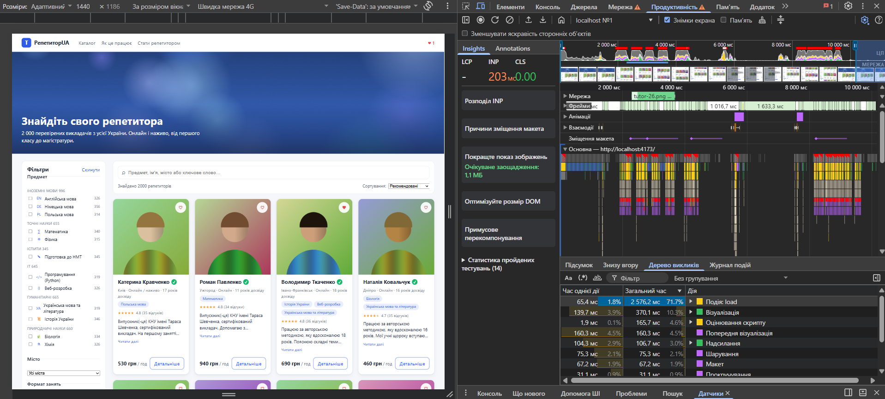
   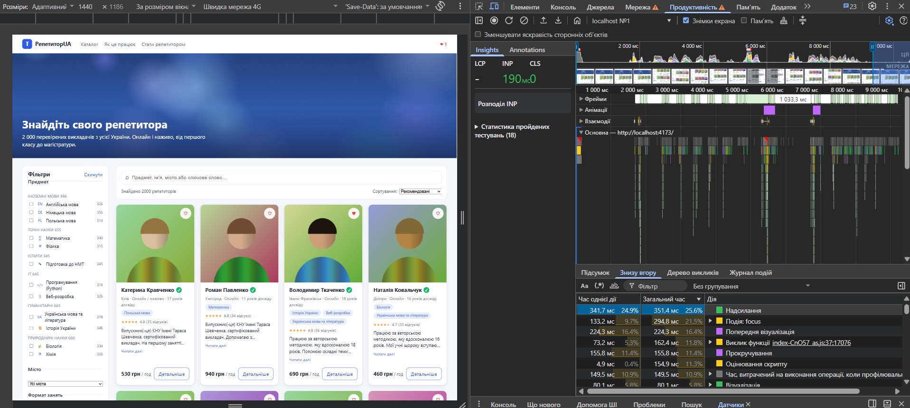

### Виправлення 5: Оптимізація головного зображення Hero за допомогою WebP

- **Коміт:** b6977d (perf: compress hero banner with WebP and JPEG fallback)
- **Гіпотеза:** Зменшення обсягу головного зображення Hero для скорочення часу завантаження ресурсів та покращення показників Lighthouse.
- **Сценарій:** Початкове завантаження сторінки, аудит Lighthouse у режимі Navigation, Desktop.

**Підтверджена причина:**

Під час аналізу Lighthouse було виявлено, що початкове головне зображення `hero.png` мало розмір приблизно 1286 КіБ, хоча відображалося на сторінці у розмірі близько 1130 × 424 px. У звіті також зазначалася потенційна економія понад 1200 КіБ у разі оптимізації цього ресурсу.

Великий розмір зображення збільшував обсяг даних, які браузер мав завантажити для відображення початкової області сторінки. Оскільки Hero розташований у верхній частині сторінки, його завантаження могло впливати на час відображення основного контенту.

**Що змінено у коді:**

1. Головне зображення Hero конвертовано у сучасний формат WebP для зменшення розміру файлу.
2. Додано JPEG-версію зображення як альтернативний формат для браузерів, які не підтримують WebP.
3. У `Header.jsx` використано елемент `<picture>` з двома джерелами зображення: WebP через `<source>` та JPEG через ``.
4. Збережено атрибут `fetchPriority="high"`, оскільки головне зображення розташоване у початковій видимій області сторінки та може бути LCP-елементом.
5. Збережено атрибути `width` і `height` для резервування місця під зображення та запобігання зсувам макета.

**Результати вимірювань до оптимізації:**

| Метрика | Запуск 1 | Запуск 2 | Запуск 3 | Медіана |
| :--- | :---: | :---: | :---: | :---: |
| Lighthouse Performance Score | 64 | 60 | 60 | **60** |
| LCP (Largest Contentful Paint), с | 1,2 | 1,3 | 1,4 | **1,3** |
| FCP (First Contentful Paint), с | 0,8 | 0,8 | 0,8 | **0,8** |
| TBT (Total Blocking Time), мс | 880 | 1180 | 1110 | **1110** |
| CLS (Cumulative Layout Shift) | 0 | 0 | 0 | **0** |
| Speed Index, с | 2,4 | 3,0 | 2,9 | **2,9** |

**Результати вимірювань після оптимізації:**

| Метрика | Запуск 1 | Запуск 2 | Запуск 3 | Медіана |
| :--- | :---: | :---: | :---: | :---: |
| Lighthouse Performance Score | 60 | 57 | 59 | **59** |
| LCP (Largest Contentful Paint), с | 1,3 | 1,5 | 1,4 | **1,4** |
| FCP (First Contentful Paint), с | 0,8 | 0,8 | 0,8 | **0,8** |
| TBT (Total Blocking Time), мс | 1160 | 1500 | 1210 | **1210** |
| CLS (Cumulative Layout Shift) | 0 | 0 | 0 | **0** |
| Speed Index, с | 2,8 | 3,4 | 3,0 | **3,0** |

**Порівняння результатів до та після оптимізації:**

| Метрика | До (медіана) | Після (медіана) | Зміна |
| :--- | :---: | :---: | :---: |
| **Lighthouse Performance Score** | 60 | 59 | −1 бал (регресія) |
| **LCP**, с | 1,3 | 1,4 | +7,7% (регресія) |
| **FCP**, с | 0,8 | 0,8 | Без змін |
| **TBT**, мс | 1110 | 1210 | +9,0% (регресія) |
| **CLS** | 0 | 0 | Без змін |
| **Speed Index**, с | 2,9 | 3,0 | +3,4% (регресія) |

**Аналіз результатів:**

Після внесення змін показники Lighthouse не продемонстрували очікуваного покращення. Performance Score зменшився з 60 до 59 балів, LCP збільшився з 1,3 до 1,4 секунди, а TBT — з 1110 до 1210 мс. FCP та CLS залишилися без змін.

Таким чином, хоча використання WebP та JPEG fallback дозволяє оптимізувати формат і потенційний обсяг головного зображення, проведені вимірювання не підтвердили покращення загальної продуктивності сторінки після цього виправлення. Отримані результати можуть залежати також від інших ресурсів і коливань умов вимірювання. Тому це виправлення не можна вважати таким, що покращило показники Lighthouse.

**Докази:**

   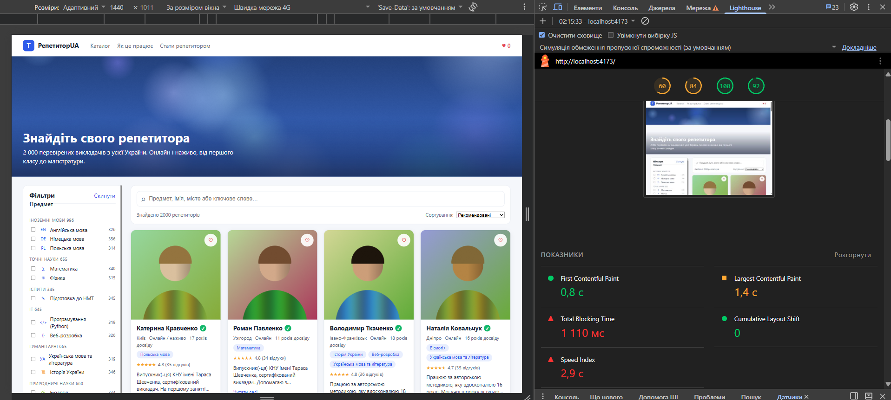
   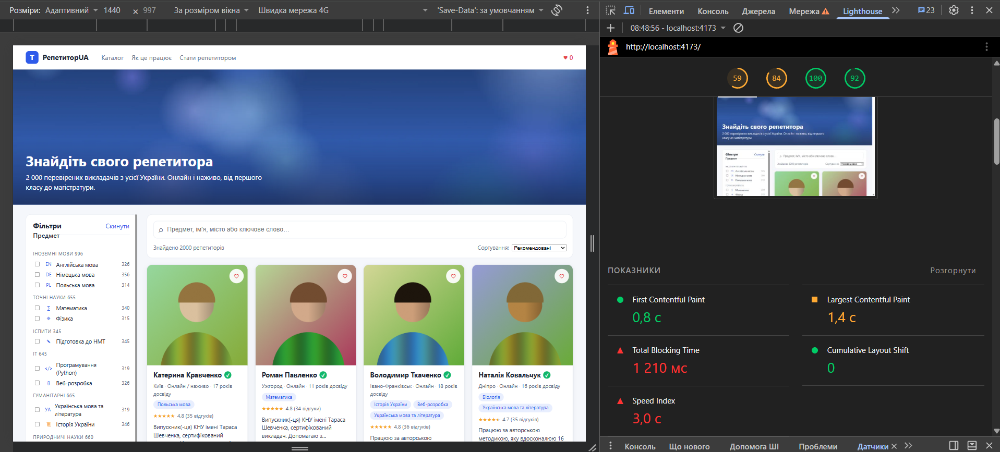

---

## 5. Регресійний тест

**Файл:** `src/__tests__/TutorCard.test.jsx`
**Коміт:** 796aca (test: add regression test for tutor image optimization)

**Що перевіряє:** тест контролює наявність оптимізованих атрибутів у зображенні картки репетитора: `loading="lazy"`, `decoding="async"`, `width="300"` та `height="300"`. Це дає змогу перевірити, що зображення завантажується із відкладеним завантаженням, асинхронним декодуванням і має задані розміри.

### 5.1. Результат до виправлення

Початкова версія компонента `TutorCard.jsx` не містила оптимізованих атрибутів зображення. Для перевірки тест запускається на цій версії компонента.

   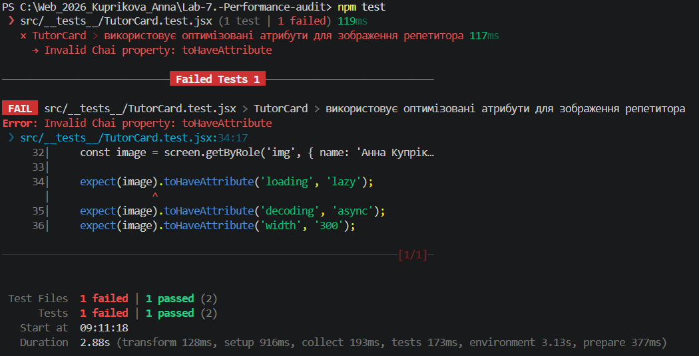

### 5.2. Результат після виправлення

Після повернення оптимізованої версії компонента та запуску `npm test` усі тести успішно пройшли:

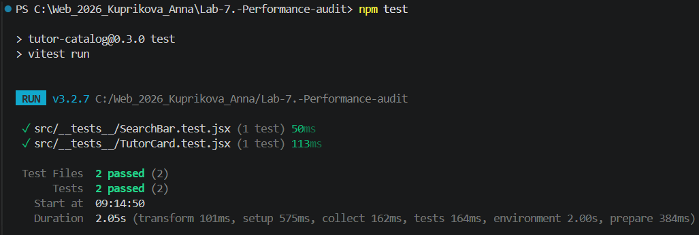

- `SearchBar.test.jsx` — 1 тест пройшов;
- `TutorCard.test.jsx` — 1 тест пройшов;
- загалом: 2 тестові файли та 2 тести пройшли.

Таким чином, перевірка підтвердила наявність усіх чотирьох оптимізованих атрибутів у зображенні картки репетитора.

### 5.3. Пояснення

Регресійний тест створено для перевірки результату оптимізації завантаження зображень у компоненті `TutorCard`.

У початковій версії компонента зображення містило лише атрибути `src` та `alt`. Після оптимізації додано чотири атрибути:

- `loading="lazy"` — відкладає завантаження зображень, які ще не потрапили у видиму область сторінки;
- `decoding="async"` — дозволяє браузеру виконувати декодування зображення асинхронно;
- `width="300"` та `height="300"` — задають розміри зображення та допомагають браузеру заздалегідь зарезервувати для нього місце в розмітці.

Тест перевіряє фактичні значення цих HTML-атрибутів за допомогою `getAttribute()` та `toBe()`.

На початковій версії компонента перевірка має завершуватися невдачею, оскільки необхідні атрибути відсутні. Після оптимізації всі перевірки проходять. Це підтверджує, що тест виявляє відсутність потрібних атрибутів і контролює збереження оптимізованої поведінки компонента.

---

## 6. Перевірені ділянки коду, які не потребували оптимізації

Під час аудиту перевірялися не лише ділянки, у яких згодом було виконано оптимізацію, а й інші компоненти та функції, які потенційно могли впливати на продуктивність застосунку.

Рішення про оптимізацію приймалося на основі результатів профілювання. Якщо вимірювання не підтверджували суттєвого впливу певної ділянки коду на час виконання операцій або взаємодію з інтерфейсом, додаткові зміни не вносилися. Це дозволило уникнути ускладнення коду без доведеної потреби.

## 6. Перевірені компоненти та функції, які залишилися без змін

Під час аудиту було проаналізовано не лише ділянки коду, у яких виявилися проблеми з продуктивністю, а й ті, що потенційно могли створювати додаткове навантаження. Проте результати профілювання показали, що їхній вплив на швидкодію застосунку є незначним. Тому ці фрагменти було вирішено не змінювати, уникаючи зайвого ускладнення коду.

### 6.1. Отримання довідкових даних

- **Файли:** `src/api/reference.js`, `useReferenceData.js`.
- **Причина перевірки:** отримання списків міст, регіонів і цін реалізовано через асинхронний ланцюжок промісів, що може створювати додаткові витрати під час ініціалізації застосунку.
- **Результат перевірки:** для збереження отриманих даних використовується кеш `Map`. Завантаження довідників відбувається під час початкового монтування застосунку, а сумарний час виконання становить менше ніж 0,8 мс.
- **Причина відмови від оптимізації:** операції виконуються один раз і не впливають на подальшу взаємодію користувача з каталогом.

### 6.2. Формування тестових даних репетиторів

- **Файли:** `src/data/tutors.js`, `src/data/random.js`.
- **Причина перевірки:** під час запуску застосунку генеруються 2000 записів репетиторів, які містять інформацію про досвід, відгуки, рейтинги та біографії.
- **Результат перевірки:** генерація виконується один раз під час завантаження JavaScript-модуля, до першого рендерингу React. Її тривалість становить приблизно 12–14 мс.
- **Причина відмови від оптимізації:** генератор використовується для створення тестових даних. Його оптимізація не дала б суттєвого результату для основних сценаріїв роботи застосунку, оскільки в реальному середовищі дані зазвичай отримуються від сервера.

### 6.3. Функції форматування значень

- **Файл:** `src/utils/format.js` (`formatPrice`, `pluralize`, `formatDate`).
- **Причина перевірки:** функції багаторазово викликаються під час формування карток репетиторів для відображення вартості занять, досвіду та дат відгуків.
- **Результат перевірки:** після впровадження пагінації на сторінці одночасно відображається лише поточна порція карток — 18 записів. Сумарний час виконання операцій форматування для цієї кількості карток становить менше ніж 0,15 мс на кадр.
- **Причина відмови від оптимізації:** отримане значення є незначним порівняно з бюджетом одного кадру (приблизно 16,6 мс). Додаткове кешування або ускладнення цих функцій не має практичної потреби.

---

## 7. Підсумкове порівняння результатів за трьома сценаріями

У таблиці наведено порівняння медіанних показників продуктивності застосунку до оптимізації та після виконання відповідних виправлень. Для кожного сценарію використано метрики, які можна зіставити між початковими та повторними вимірюваннями.

| Сценарій | Метрика | До оптимізації | Після оптимізації | Покращення |
| :--- | :--- | :---: | :---: | :---: |
| **1. Завантаження сторінки** | Lighthouse Performance Score | 39 | 59 | **+51,3%** |
| | LCP, с | 3,7 | 1,4 | **62,2%** |
| | FCP, с | 0,7 | 0,8 | −14,3% |
| | TBT, мс | 6940 | 1210 | **82,6%** |
| | CLS | 0 | 0 | Без змін |
| **2. Пошук** | INP, мс | 9977 | 132 | **98,7%** |
| | Найдовша JS-задача, мс | 7221 | 95 | **98,7%** |
| | Сума блокування Long Tasks, мс | 10466 | 193 | **98,2%** |
| | Кількість Long Tasks, шт. | 5 | 7 | +40% задач |
| **3. Взаємодія зі списком** | INP, мс | 4179 | 121 | **97,1%** |

### Загальний аналіз результатів

За результатами порівняння початкових і фінальних вимірювань можна зробити такі висновки:

1. **Завантаження сторінки:** Lighthouse Performance Score збільшився з 39 до 59 балів. Час LCP скоротився на 62,2%, а TBT — на 82,6%. Це свідчить про покращення швидкості відображення основного контенту та зменшення блокування головного потоку браузера.
2. **Пошук:** INP зменшився на 98,7%, а найдовша JavaScript-задача — також на 98,7%. Сумарний час блокування Long Tasks скоротився на 98,2%, що свідчить про значне прискорення обробки пошукового запиту.
3. **Взаємодія зі списком:** INP зменшився на 97,1%, що свідчить про швидшу реакцію інтерфейсу на дії користувача.

Водночас не всі показники покращилися: FCP збільшився на 14,3%, а кількість Long Tasks під час пошуку зросла з 5 до 7. Також п'яте виправлення не забезпечило додаткового покращення показників Lighthouse, тому його результат оцінювався окремо.

Отже, проведені оптимізації дали найбільш помітний ефект у скороченні часу блокування головного потоку та прискоренні обробки користувацьких взаємодій. Результати підтверджують доцільність оптимізації початкового DOM, пошукових обчислень і роботи з макетом сторінки.